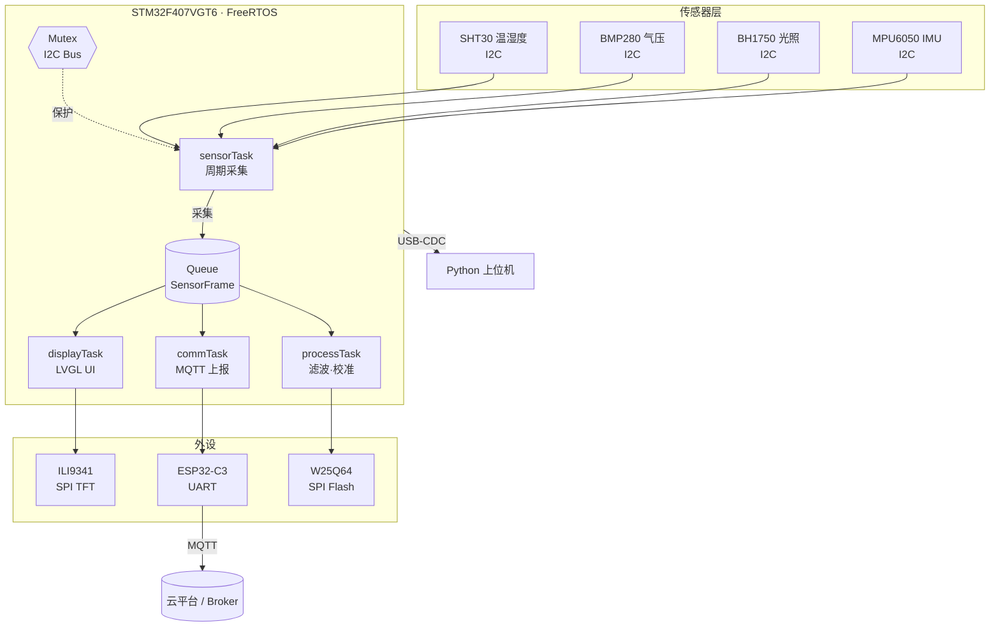

# STM32 多传感器物联网终端

> 基于 STM32F4 + FreeRTOS 的自研硬件数据采集终端：自主完成原理图设计、PCB 绘制、焊接调试与全栈固件开发，配套的 Python 上位机实现实时曲线与数据落盘。

**STM32F4 + FreeRTOS based multi-sensor IoT terminal with custom PCB, LVGL UI, wireless uplink and a Python host application.**

    

> **项目状态：开发中（2026-10-08 起，12 周计划）**
>
> 本文档描述的是项目的**目标形态与设计规格**，实际完成进度见 [Roadmap](#roadmap) 的勾选状态。
> 开发过程中的每次踩坑与解决记录在 [`docs/debug-log/`](docs/debug-log/)；技术手册与速查见 [`docs/`](docs/)。
> 所有性能数字均为实测，未实测项标注"待测"——不使用估算值。

---

## 项目背景

面向的环境监测 / 设备状态巡检场景：需要一台低功耗、带本地显示、可远程上报的多通道采集终端。

项目的完整链路均由本人独立完成，包含 **原理图设计 → PCB Layout → 焊接与硬件调试 → BSP 与驱动编写 → RTOS 应用层 → 上位机**，而非使用成品开发板拼凑。这也是本项目与常见课设的主要区别。

---

## 功能特性

| 类别 | 实现内容 |
| --- | --- |
| 多通道采集 | 温湿度 / 气压 / 光照 / 三轴加速度，统一采集周期与时间戳对齐 |
| 实时系统 | FreeRTOS 四任务划分，队列传递数据、互斥量保护共享 I2C 总线 |
| 本地交互 | LVGL 驱动的 320×240 图形界面，实时数值 + 历史曲线 + 参数设置页 |
| 无线上报 | ESP32-C3 通过 MQTT 上报云端，支持断线重连与本地缓存补传 |
| 远程升级 | 预留 OTA 接口（Bootloader + App 双分区） |
| 上位机 | Python `pyserial` 实时绘图，CSV 落盘，支持参数下发与日志回放 |

---

## 系统架构



### 任务划分与同步策略

| 任务 | 优先级 | 周期 | 职责 | 栈用量 |
| --- | --- | --- | --- | --- |
| `sensorTask` | 3（高） | 100 ms | 轮询四路传感器，打包成统一数据帧 | 待实测 |
| `processTask` | 2 | 200 ms | 滑动平均滤波、零点校准、越限判定 | 待实测 |
| `displayTask` | 2 | 50 ms | LVGL 界面刷新与触摸响应 | 待实测 |
| `commTask` | 1（低） | 1000 ms | MQTT 上报、断线重连、缓存补传 | 待实测 |

**同步机制说明（面试高频考点，设计时已明确考虑）：**

- **队列** 用于 `sensorTask → 其余任务` 的数据传递：解耦采集与消费速率，避免消费者阻塞采集节拍。
- **互斥量** 保护共享的 I2C 总线：四路传感器挂同一总线，任两任务并发访问会造成时序错乱；这里未使用信号量，因为需要的是互斥而非同步。
- **事件组** 用于按键/越限等离散事件的广播，替代轮询标志位。
- 中断中仅释放信号量并调用 `xQueueSendFromISR()`，**不在中断上下文中做任何耗时处理**。

---

## 硬件设计

### 物料清单（BOM）

| 器件 | 型号 | 接口 | 选型理由 |
| --- | --- | --- | --- |
| MCU | STM32F407VGT6 | — | 168 MHz、1 MB Flash / 192 KB RAM，足够跑 FreeRTOS + LVGL；资源余量留给后续 OTA |
| 温湿度 | SHT30 | I2C | 精度 ±2% RH，比 DHT11 稳定性好，标准 I2C 便于总线复用 |
| 气压 | BMP280 | I2C | 兼作温度交叉校准参考 |
| 光照 | BH1750 | I2C | 数字输出，免去光敏电阻的分压标定 |
| IMU | MPU6050 | I2C | 六轴，可用于终端姿态检测（可扩展为振动监测） |
| 显示 | ILI9341 2.8" TFT | SPI | 320×240，SPI 占用引脚少于并口屏 |
| 无线 | ESP32-C3-MINI | UART(AT) | 内置 WiFi/BLE，AT 指令降低固件复杂度 |
| 存储 | W25Q64 | SPI | 8 MB，用于离线缓存与参数存储 |
| RTC | DS3231 | I2C | 高精度温补，为数据提供可靠时间戳 |
| 电源 | AMS1117-3.3 + Type-C | — | 预留 DC-DC 位置以优化效率 |

> 完整 BOM 与位号见 [`hardware/bom.xlsx`](hardware/bom.xlsx)。

### PCB 设计要点

- 四层板（Signal / GND / Power / Signal），完整地平面保证回流路径连续
- 每个电源引脚就近放置 100 nF 去耦电容，容值按 datasheet 典型应用电路选取
- 晶振下方禁止走线与铺铜，外壳接地处理
- SPI 走线等长处理，避开板边与高频区域
- USB 差分对等长、包地处理

> 原理图、PCB 源文件与 Gerber 见 [`hardware/`](hardware/)，使用嘉立创 EDA 绘制。

---

## 目录结构

```
├── firmware/                   # 固件工程
│   ├── Core/                   # CubeMX 生成的时钟、外设初始化
│   ├── BSP/                    # 板级支持包：各外设驱动的薄封装
│   ├── Drivers/                # HAL 库与器件厂商驱动
│   ├── Middlewares/
│   │   ├── FreeRTOS/
│   │   └── LVGL/
│   ├── App/                    # 应用层：四个任务 + 协议 + 业务逻辑
│   └── CMakeLists.txt
├── hardware/                   # 硬件设计
│   ├── sch/                    # 原理图
│   ├── pcb/                    # PCB Layout
│   ├── output/                 # Gerber、坐标文件、BOM
├── upper-computer/             # Python 上位机
│   ├── main.py
│   ├── serial_reader.py
│   ├── plotter.py
│   └── requirements.txt
├── docs/                       # 文档
│   ├── 01-系统架构设计.md
│   ├── 02-通信协议.md
│   ├── 03-硬件设计说明.md
│   └── debug-log/              # 调试笔记（每解决一个问题记一篇）
├── tools/                      # 脚本工具
└── README.md
```

---

## 快速开始

### 环境要求

| 工具 | 版本 | 用途 |
| --- | --- | --- |
| STM32CubeMX | 6.x | 生成时钟树与外设初始化代码 |
| arm-none-eabi-gcc | 10+ | 交叉编译 |
| CMake | 3.20+ | 构建系统 |
| OpenOCD | 0.12+ | 下载与调试 |
| VS Code + Cortex-Debug | — | 开发调试环境 |
| Python | 3.9+ | 上位机 |

### 编译与烧录

```bash
git clone https://github.com/Zhuang-1017/stm32-iot-node.git
cd stm32-iot-node/firmware

mkdir build && cd build
cmake -DCMAKE_TOOLCHAIN_FILE=../cmake/gcc-arm-none-eabi.cmake ..
make -j8

# 通过 ST-Link 烧录
openocd -f interface/stlink.cfg -f target/stm32f4x.cfg \
        -c "program stm32-iot-node.elf verify reset exit"
```

### 运行上位机

```bash
cd upper-computer
pip install -r requirements.txt
python main.py --port COM3 --baud 115200
```

---

## 通信协议

终端与上位机 / 云端之间采用统一的自定义帧格式，兼顾可靠性与可解析性。

```
┌────────┬────────┬──────┬────────┬──────────────┬────────┬────────┐
│ 帧头    │ 长度    │ 类型  │ 设备 ID │ 载荷          │ CRC16  │ 帧尾    │
│ 2 Bytes │ 1 Byte │ 1 B  │ 2 Bytes │ N Bytes      │ 2 Bytes│ 2 Bytes│
│ AA 55   │ 0x??   │ 0x?? │ 0x????  │ sensor data │ Modbus │ 0D 0A  │
└────────┴────────┴──────┴────────┴──────────────┴────────┴────────┘
```

设计上刻意处理的三个问题：

1. **帧同步**：双字节帧头 `AA 55` 降低误判概率，接收侧用状态机逐字节解析而非整包等待。
2. **粘包 / 断帧**：采用"帧头 + 长度"组合，接收端按长度字段定界，避免依赖定时器超时。
3. **校验**：CRC16（Modbus 多项式）覆盖长度字段到载荷末尾，防止长度字节出错导致后续解析全乱。

> 完整字段定义与状态机实现见 [`docs/02-通信协议.md`](docs/02-通信协议.md)。

---

## 实测指标

> **以下数据需在系统联调完成后补充。请勿在测试前填写估算值**——面试中被追问测试条件时无法自圆其说，比数据不好看更伤。

| 指标 | 目标值 | 实测 | 测试条件 |
| --- | --- | --- | --- |
| 温度测量误差 | < ±0.5 °C | 待测 | 与标准温度计对比，25 °C 恒温 |
| 湿度测量误差 | < ±3 %RH | 待测 | 饱和盐溶液标定法 |
| 连续运行时长 | > 24 h 无异常 | 待测 | 常温持续拷机 |
| 上报丢包率 | < 1 % | 待测 | 1 Hz 上报，统计 1 万帧 |
| UI 刷新帧率 | > 20 fps | 待测 | SPI 时钟 40 MHz |
| 整机工作电流 | < 150 mA | 待测 | 5 V 供电，屏常亮 |

---

## 开发日志与技术笔记

| 目录 / 文档 | 内容 |
| --- | --- |
| [`docs/debug-log/`](docs/debug-log/) | 调试日志：现象 → 排查过程 → 根因 → 解法。每篇一个坑 |
| [`docs/STM32学习手册.md`](docs/STM32学习手册.md) | 24 个知识点详解：学什么 / 为什么 / 怎么验证 / 学到什么程度算会 |
| [`docs/git-速查表.md`](docs/git-速查表.md) | Git 命令速查与 `.gitignore` 模板 |
| [`docs/index.md`](docs/index.md) | 文档站首页 |

### 本项目的典型难点（预期）

以下是本类项目公认会踩的几个坑。实际发生时的完整排查过程会记进 `docs/debug-log/`，届时把这里的条目替换为真实记录：

- I2C 总线在多任务并发访问下数据错乱 → 引入互斥量保护共享总线
- LVGL UI 刷新卡顿 → 将 LVGL 的 `lv_timer_handler()` 独立成任务并调整优先级
- 串口接收偶发丢帧 → 由轮询改为 DMA + 空闲中断 + 环形缓冲区
- MQTT 断网后数据丢失 → 增加 W25Q64 本地缓存与补传机制

---

## Roadmap

> 状态更新于 **2026-10-08**。本项目按 12 周计划推进，当前处于**工具链就绪 + 外设驱动开发**阶段。

- [ ] 原理图与 PCB 设计、打样焊接
- [ ] 四路传感器驱动（I2C 总线复用）
- [ ] FreeRTOS 多任务重构
- [ ] LVGL 界面移植与三页 UI
- [ ] ESP32-C3 无线链路与 MQTT 上报
- [ ] W25Q64 离线缓存与补传
- [ ] Python 上位机与数据可视化
- [ ] 24 小时稳定性拷机，补齐实测数据
- [ ] OTA 双分区升级（延伸目标）

### 已完成

- [x] 工具链搭建并验证（STM32CubeIDE 2.2.0 + CMake + Ninja + GCC 14.3 + VSCode / clangd / ST-Link GDB Server）
- [x] 最小可运行固件（GPIO 输出 + 串口，在 STM32F103C8T6 上验证）

> 说明：本 README 的「功能特性」「硬件设计」「通信协议」等章节描述的是**项目目标形态**（作为设计规格），实际完成进度以本节勾选状态为准。开发过程中的每次踩坑与解决记录见 [`docs/debug-log/`](docs/debug-log/)。

### 后续规划（下一阶段）

本项目收口后，将沿用同一套工具链与硬件方法论，转向电机控制方向：

- [ ] 三相逆变与 FOC 电流闭环（下一项目 · 2027 春）
- [ ] 编码器位置 / 速度闭环

> 本项目期间会顺带完成两项前置外设验证：TIM1 互补输出 + 死区、定时器触发 ADC + DMA 同步采样（详见调试笔记）。

---

## 作者

**Zhuang1017** · 深圳大学 电子与信息工程学院 · 电子信息工程 2028 届

方向：嵌入式软件 / MCU 固件开发

GitHub：[@Zhuang-1017](https://github.com/Zhuang-1017)

> 本项目为求职导向的自主学习实践项目，欢迎交流指正。

---

## License

MIT License
